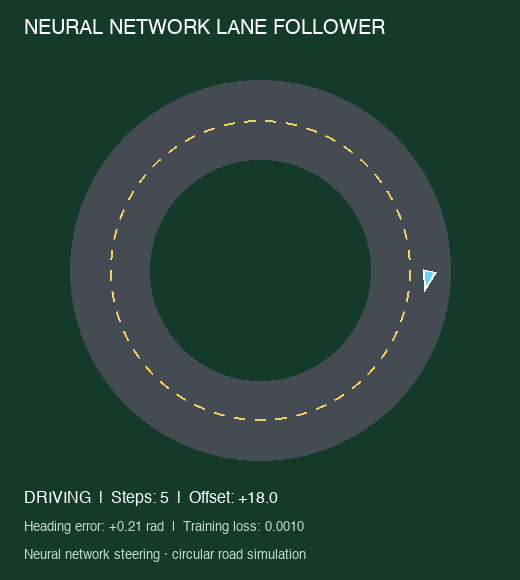

# Neural network from scratch

A small feed-forward neural network written in pure Python, without machine learning libraries. It learns using sigmoid activations, mean squared error, backpropagation, and stochastic gradient descent. The included example learns XOR, a problem that requires a hidden layer.

## Run

Requires Python 3. Run the example from the project directory:

```sh
python3 neural_network.py
```

It prints the training loss and predicted probability for each XOR input. Run the tests with:

```sh
python3 -m unittest discover -s tests -v
```

## Use

```python
from neural_network import NeuralNetwork

samples = [([0, 0], [0]), ([0, 1], [1]), ([1, 0], [1]), ([1, 1], [0])]
network = NeuralNetwork([2, 4, 1], seed=42)
losses = network.train(samples, epochs=10000, learning_rate=1.0, seed=42)
print(network.predict([0, 1]))
```

The layer sizes include the input and output layers. Each target must have the same length as the output layer. Outputs are between 0 and 1. The returned loss history is the average training loss observed during each epoch, as weights are updated. Seeds make initialization and training order reproducible. This educational implementation prioritizes clarity over performance and is not intended for large datasets.

## Lane-following simulation



*Animated preview rendered from the trained simulator.*

Train the same network to steer a small car around a circular road:

```sh
python3 lane_following.py
```

The demo opens a window showing the car, its offset from the lane center, and its heading error. Press **Space** to pause or resume and **R** to restart. The car stops if it leaves the road. The visual demo uses Python's `tkinter`, which must be available in your Python installation. To run without a window:

```sh
python3 lane_following.py --headless
```

The simulation generates example states (position relative to the lane and heading relative to the road). A simple hand-written steering rule labels those states, and the neural network learns to imitate that rule. During the drive, the network alone predicts the steering command at each step. The output is a continuous steering value, not an image or a real-world driving decision.

Try changing the initial `offset` and `angle` in `Car`, the training examples, or the network's layer sizes and observe how the car behaves. The circular road has a fixed radius, and the inputs are ideal measurements; this is an educational simulation, not a self-driving system for a real vehicle.
